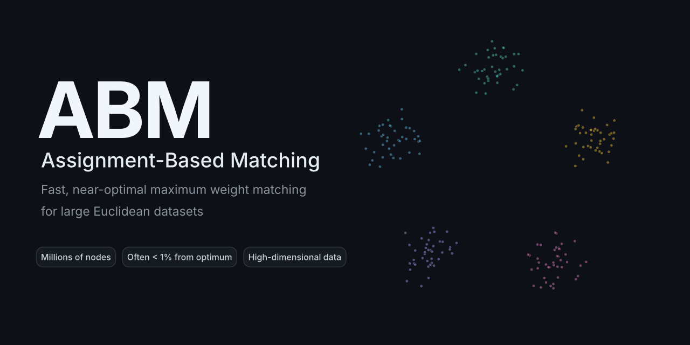

<p align="center"></p>

<p align="center">
  <a href="<PAPER_URL>"></a>
  <a href="LICENSE"></a>
   version">
</p>

<p align="center">
  <a href="#overview">Overview</a> ·
  <a href="#installation">Installation</a> ·
  <a href="#quick-start">Quick start</a> ·
  <a href="#experimental-results">Experimental results</a> ·
  <a href="#citation">Citation</a> ·
  <a href="#contact">Contact</a>
</p>

---

## Overview

**ABM (Assignment-Based Matching)** is a heuristic for the maximum weight matching problem on graphs whose nodes are points in $\mathbb{R}^d$ — for example, the rows of a tabular dataset with $d$ features — and whose edge weights are the Euclidean distances between them or distances induced by any other metric norm.

Maximum weight matching is solvable in polynomial time, but existing exact algorithms do not scale to large datasets. ABM consistently produces high-quality matchings, often within 1% of the optimum, and a decomposition strategy lets it handle instances with several million nodes.

## Installation

1. Clone this repository  
2. Create and activate a virtual environment
3. Install the required dependencies (see requirements.txt)

## Quick start


```python
import numpy as np
from abm import run_abm

# Illustrative example
X = np.array([
    [7, 5], # 0
    [5, 4], # 1
    [7, 8], # 2
    [8, 5], # 3
    [4, 9], # 4
    [5, 2], # 5
    [5, 10], # 6
    [2, 2], # 7
    [3, 1], # 8
    [1, 8], # 9
    ])

# Set control parameters
control_parameters = {'output_as_pairs': True}

pairs = run_abm(X, params=control_parameters)

for i, j in pairs:
    print(f'[{i}, {j}]')

```

Output:

```text
[0, 7]
[1, 4]
[3, 9]
[5, 6]
[2, 8]
```

### Control parameters

The control parameters are specified in a dictionary that is passed to `run_abm` as the `params` argument (see example above). Parameters that are not specified take their default values.

| Parameter | Default | Description |
|---|---|---|
| `output_as_pairs` | `False` | If `True`, returns the matching as pairs of object indices. If `False`, returns an array of labels in which the two objects of each pair share the same label. |
| `use_decomposition` | `False` | Whether the decomposition strategy is used to generate an initial matching. If `False` no decomposition is used. |
| `assignment_problem_size_for_decomposition` | `1000` | Size of the assignment problems solved in the decomposition (positive integer). Only used if `use_decomposition` is `True`. |
| `n_jobs_decomposition` | `None` | Number of parallel jobs for the decomposition: `None`, a positive integer (maximum number of concurrently running jobs), or `-1` (use all available CPUs). Only used if `use_decomposition` is `True`. |
| `use_improvement` | `False` | Whether to run the improvement phase on the initial matching. |
| `assignment_problem_size_for_improvement` | `1000` | Size of the assignment problems solved in the improvement phase: a positive integer, or `-1` to use all objects. Only used if `use_improvement` is `True`. |
| `n_jobs_improvement` | `None` | Number of parallel jobs for the improvement phase: `None`, a positive integer (maximum number of concurrently running jobs), or `-1` (use all available CPUs). Only used if `use_improvement` is `True`. |
| `n_improvement_iterations` | `10` | Number of improvement iterations: `None` or a positive integer. Only used if `use_improvement` is `True`. |
| `metric` | `'sqeuclidean'` | Distance function used to determine the edge weights, e.g. `'euclidean'`, `'sqeuclidean'` or `'cityblock'`. |
| `random_seed` | `24` | Seed for the random number generator, for reproducible results: `None` or a positive integer. |

## Experimental results

The detailed experimental results from our experiments for the L1 (cityblock), L2 (Euclidean), and L2 squared distance metrics are available in the PDFs below.

### Small datasets

- [Full results on small instances](./Full%20results%20on%20small%20instances.pdf)

### Medium-sized datasets

- [Full results on medium-sized instances](./Full%20results%20on%20medium-sized%20instances.pdf)

### Large-sized datasets

- [Full results on large-sized instances](./Full%20results%20on%20large-sized%20instances.pdf)

### Ablation study

- [Full results on ablation study](./Full%20results%20on%20ablation%20study.pdf)

## Citation

If you use this algorithm in your research, please cite the following paper:

Baumann, P., Goldschmidt O., Hochbaum D.S. (2026) Solving large-scale maximum weight non-bipartite matching in Euclidean space. working paper.

Bibtex:
```
@misc{baumann2026solving,
      title={Solving large-scale maximum weight non-bipartite matching in Euclidean space}, 
      author={Philipp Baumann and Olivier Goldschmidt and Dorit S. Hochbaum},
      year={2026},
      note={working paper}
}
```

## License

This project is licensed under the [MIT LICENSE](LICENSE).

## Contact

Questions and bug reports are welcome via [GitHub Issues](https://github.com/phil85/abm/issues), or by email to Philipp Baumann (philipp.baumann@unibe.ch).


